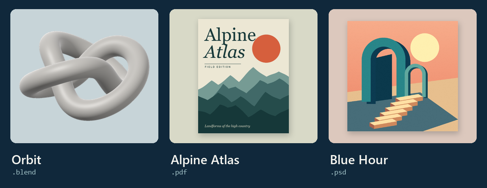

# ZMSviewer

ZMSviewer показывает миниатюры файлов прямо в Проводнике Windows. В папке с моделями видно форму объекта, у книги — обложку, у PDF — первую страницу. Файлы обрабатываются на компьютере и сохраняют исходные даты изменения.

**Windows 10 и 11 · x64 · Установка для текущего пользователя**

**[Скачать установщик 1.1.0](https://github.com/zames1992/ZMSviewer/releases/download/v1.1.0/ZMSviewer-Setup.exe)** · [ZIP с инструкцией](https://github.com/zames1992/ZMSviewer/releases/download/v1.1.0/ZMSviewer-1.1-Windows-x64.zip) · [Все версии](https://github.com/zames1992/ZMSviewer/releases)



## Установка и обновление

1. Запустите `ZMSviewer-Setup.exe`. Если выбрали ZIP, сначала распакуйте его. Права администратора не требуются.
2. Отметьте нужные группы файлов. Для PDF включите **PDF и электронные книги**, для PSD — **Картинки**. При переходе с версии 1.0 выберите **Обновить до версии 1.1**. Мастер сохранит ваш выбор форматов.
3. Откройте папку с файлами и выберите **Вид → Крупные значки**. Эскизы также видны в режимах средних и огромных значков.

**Что произойдёт со старыми моделями?** Мастер обновит общий кэш миниатюр текущей учётной записи. При следующем просмотре папок Проводник заново создаст эскизы уже сохранённых файлов. Это затрагивает и миниатюры других форматов. Файлы остаются на своих местах. Первая отрисовка больших сцен может занять время.

## Поддерживаемые форматы

| Файлы | Расширения | Что видно в Проводнике |
| --- | --- | --- |
| 3D-модели | OBJ, STL, FBX, 3DS, BLEND, MA, MB, PLY, GLB, glTF | Модель в сером материале в ракурсе три четверти. Для Blender доступно также сохранённое превью. |
| Изображения | PSD, PSB, TIF, TIFF, TGA, EXR, HDR, DDS | Содержимое изображения с сохранением пропорций. |
| Документы и комиксы | PDF, CBZ | Первая страница. В CBZ учитывается числовая нумерация файлов. |
| Электронные книги | EPUB, FB2, FBZ, MOBI, AZW, AZW3 | Обложка. Если обложки нет, для поддерживаемых книг используется название из метаданных. |

Поддерживаются обычные файлы Blender и варианты со сжатием gzip и Zstandard. Для glTF нужна встроенная геометрия без Draco. В PSD и PSB используются сохранённый композит, встроенная миниатюра или обычные растровые слои. Для точного отображения сложных масок и эффектов нужен композит или миниатюра. PDF с паролем и книги с DRM не поддерживаются.

## Настройки

Откройте **ZMSviewer** в меню **Пуск**, чтобы изменить группы файлов, восстановить установку или удалить программу. Если эскизов нет во всех папках, проверьте настройку **Параметры Проводника → Вид → Всегда отображать значки, а не эскизы**. Для показа миниатюр этот флажок должен быть снят.

## Сборка из исходников

Установите инструменты C++ для классических приложений Visual Studio 2022 и Windows SDK. Запустите сборку из корня репозитория.

```bat
source\build.bat
```

В `source\bin` появятся обработчик `ZMSviewer.dll`, инструмент проверки `ThumbTest.exe` и установщик `ZMSviewer-Setup.exe`. [Тесты](source/tests) · [Сторонние компоненты и лицензии](source/THIRD_PARTY.txt)

## English

ZMSviewer adds local File Explorer thumbnails for 3D models, Photoshop images, PDFs, comics and e-books on **64-bit Windows 10 and 11**. Run the installer, select the file groups and open a folder in Large icons view. Upgrading from 1.0 keeps your selections. Setup refreshes the current user's shared thumbnail cache, so Explorer rebuilds previews for existing files as you browse. [Download the Windows installer](https://github.com/zames1992/ZMSviewer/releases/download/v1.1.0/ZMSviewer-Setup.exe)
